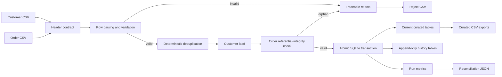

# YottaFlex Batch Orders Pipeline

A transactional batch pipeline that ingests customer and order CSV files, validates
schema and business rules, quarantines invalid records, preserves change history,
and publishes analytics-ready tables to SQLite and CSV.

The implementation uses only the Python standard library at runtime. This keeps the
review path fast and reproducible while still demonstrating data contracts,
idempotency, observability, recovery behavior, and automated validation.

## Quick start

Requirements: Python 3.10 or newer.

```bash
python3 -m venv .venv
source .venv/bin/activate
python -m pip install -e ".[dev]"

yotta-pipeline run \
  --customers sample_data/input/customers.csv \
  --orders sample_data/input/orders.csv \
  --output-dir output/sample
```

Expected sample result:

```text
customers_input=6, customers_published=3
orders_input=8, orders_published=3
rejected_count=8, run_balance_check=true
```

Inspect these generated artifacts:

```text
output/sample/pipeline.db
output/sample/curated/customers_curated.csv
output/sample/curated/orders_curated.csv
output/sample/runs/<run_id>/metrics.json
output/sample/runs/<run_id>/reconciliation.json
output/sample/runs/<run_id>/rejects.csv
```

Run the same command again to verify idempotency. The second execution returns
`status=skipped` and does not create duplicate rows.

## Architecture



The entire batch is a single database transaction. A batch-level failure rolls back
data changes and leaves a failed run record with the failure reason. Row-level data
quality failures are quarantined and do not prevent valid rows from publishing.

## Source contracts

CSV columns are exact and ordered. Unexpected, missing, or reordered columns fail the
batch as schema drift.

`customers.csv`:

```text
customer_id,full_name,email,country_code,updated_at
```

`orders.csv`:

```text
order_id,customer_id,order_ts,status,amount,currency,updated_at
```

See [the data dictionary](docs/data_dictionary.md) for types, nullability, keys,
derived fields, and rule details.

## Processing rules

- IDs are trimmed, required, and limited to stable alphanumeric/underscore/hyphen values.
- Timestamps must be timezone-aware ISO-8601 and are normalized to UTC `Z` format.
- Emails are lowercased; country and currency codes are uppercased.
- Amounts must be numeric, non-negative, and no greater than 1,000,000.
- Order statuses are `pending`, `completed`, `cancelled`, or `refunded`.
- Supported currencies are USD, EUR, GBP, and INR. A documented fixed rate derives
  `amount_usd`; this is intentionally deterministic rather than financially current.
- Within a batch, the greatest `updated_at` wins for duplicate IDs. A row-number
  tie-break makes the result deterministic. Losing records are quarantined.
- Orders must reference a customer already curated or valid in the same batch.
- Older late-arriving versions are retained in history but do not replace current state.

## Idempotency, retry, restart, and backfill

The pipeline hashes both input files plus a pipeline-version marker. If the same
fingerprint has already succeeded, it returns the original run ID and skips processing.
This provides safe at-least-once orchestration without duplicate targets.

Failed batches can be retried after correcting the source or schema. Because publishing
is atomic, there is no partially committed batch to clean up. Backfills use the same CLI
with historical files; `updated_at` prevents an older version from overwriting newer
current state, while the history tables preserve that arrival.

## Tests

```bash
pytest
ruff check src tests
```

The automated suite covers:

- happy path and reconciliation;
- header-only empty batches;
- malformed rows and unexpected schema changes;
- null IDs, invalid references, and traceable rejects;
- duplicate resolution;
- negative amounts, invalid statuses, and timestamp ordering;
- deterministic currency conversion;
- identical reruns;
- late/out-of-order updates and history preservation;
- deterministic, configurable data generation.

## Generate a larger dataset

```bash
yotta-pipeline generate \
  --output-dir output/generated \
  --customers 10000 \
  --orders 100000 \
  --seed 6282 \
  --invalid-rate 0.01

yotta-pipeline run \
  --customers output/generated/customers.csv \
  --orders output/generated/orders.csv \
  --output-dir output/large
```

The generator uses a fixed seed and labels invalidity through deterministic rule
violations rather than embedding expected-answer columns in the input.

## Performance

On the candidate development machine (Apple Silicon macOS, Python 3.12), a run with
10,000 customers and 100,000 orders completed in **2.09 seconds**. It published 10,000
customers and 99,000 orders and quarantined the configured 1,000 invalid orders.

The main optimization is a single SQLite transaction plus indexed primary/foreign-key
lookups, avoiding per-row commits. For multi-million-row workloads, the next step would
be streaming/chunked validation and staging-table set operations instead of retaining a
batch in memory.

## Repository map

```text
src/yotta_pipeline/       Pipeline, contracts, generator, SQLite target, and CLI
tests/                    Automated tests
sample_data/input/        Small reproducible mixed-validity batch
sample_data/expected/     Stable expected outputs and reconciliation
docs/                     Data dictionary, operations, design decisions, performance
ai/                       AI-use disclosure and prompt history
```

## Assumptions and limitations

- Each run receives exactly one customer file and one order file.
- Exact header matching is a deliberate fail-closed schema-drift policy.
- Fixed FX rates demonstrate deterministic derivation; production rates require a
  versioned reference dataset and effective dates.
- SQLite is appropriate for a portable vertical slice, not concurrent distributed loads.
- Input files are UTF-8 CSV. Quoted commas are supported by Python's CSV parser.
- Curated CSV exports are snapshots of all current rows, while SQLite is authoritative.

More detail is in [design and trade-offs](docs/design_tradeoffs.md) and
[operations](docs/operations.md). Ready-to-run validation examples are in
[reconciliation queries](docs/reconciliation_queries.sql). AI assistance is disclosed in
[AI use](ai/AI_USE.md), with the required [prompt history](ai/PROMPT_HISTORY.md).
